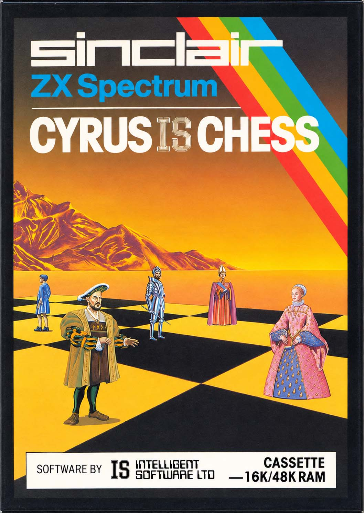
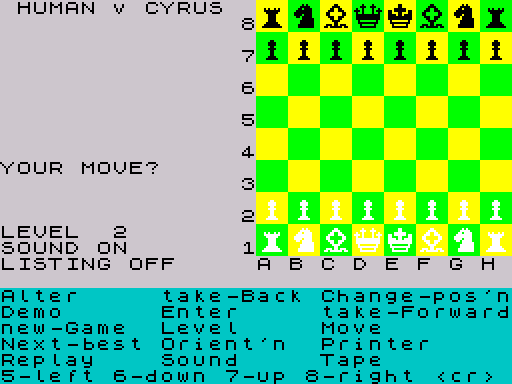

<h1 align="center">Cyrus IS Chess</h1>

<p align="center">
  <b>Richard Lang's 1983 ZX Spectrum chess program, reborn as a UCI engine in Zig, faithful move for move.</b>
</p>

<p align="center">
  
  
  
  
  
  <a href="LICENSE"></a>
</p>

<p align="center">
  
  &nbsp;&nbsp;
  
</p>

---

**Cyrus** was written by **Richard Lang**. In 1981 it won the second **European Microcomputer Chess Championship**, and in **1983** it was published as **Cyrus IS Chess** for the Sinclair **ZX Spectrum** by **Intelligent Software Ltd**, on a cassette with a 16K and a 48K version. Lang went on to write the Psion and Mephisto programs that dominated the world microcomputer championships for the rest of the decade.

This project is a port of the **48K version** to a modern **UCI** chess engine. It plays the same moves as the original, for the same reasons. Its search and evaluation are the original's, translated from the Z80 machine code and checked against that code running in an emulator. On top of that, it can search as deep as you let it, manage a clock, and report its thinking to any UCI chess GUI.

## Contents

- [How Cyrus plays](#how-cyrus-plays)
- [What the port adds](#what-the-port-adds)
- [Bugs fixed in the original](#bugs-fixed-in-the-original)
- [Conversion philosophy](#conversion-philosophy)
- [Building and running](#building-and-running)
- [UCI options](#uci-options)
- [How it was verified](#how-it-was-verified)
- [Documentation](#documentation)
- [Credits and license](#credits-and-license)

## How Cyrus plays

Everything here describes the original program, and therefore the port. The details, with addresses, are in [`docs/arch/`](docs/arch/00-overview.md).

### Board representation

- **A 0x88 board** of 128 bytes: square = (8 − rank) × 16 + file, so a single `AND $88` test detects any move off the edge. The unused half of each row holds program variables, which the move generator and evaluation sometimes read as if they were squares. The port reproduces those reads exactly.
- **Piece records:** 16 slots per side (king, queen, two rooks, two bishops, two knights, eight pawns). Each holds the piece's square, a type byte and the attack bytes that the evaluation fills in. A promoted piece stays in its pawn's slot. Moves are generated in slot order, so slot order *is* move order.
- **Castling rights** are the "has moved" bits in the king and rook type bytes. **En passant** comes from the last-move record rather than from a stored square.
- **Move lists** are 4-byte entries `[score, from, to, flags]`, one list per ply, with a header.
- **Scores** are a single unsigned byte, with `$80` meaning equal and 8 units per pawn. Mates are not scored by distance, so the shortest mate is tracked separately.

### Search

- **Alpha-beta negamax, fixed depth, fail-hard.** It is written as a state machine over plies, not as recursive code.
- **Move ordering by static evaluation:** at every node, Cyrus first *makes, evaluates and unmakes every move*. It then searches the killer move first, then the best statically scored move, then the rest in descending order of score.
- **Selective search beyond the full-width depth:** every move is made and evaluated, and anything that fails high cuts off. **Checks and threats are extended** by up to two extra plies (rarely three). When the evaluation predicts a recapture, that recapture is tried first.
- **Forward pruning** discards moves whose static score falls too far below the best. The margin depends on the game phase.
- **Repetition** is handled at the root: Cyrus scores the move that undoes its own last move as a draw, and the other moves must beat it.
- **No clock and no iterative deepening.** A *level* fixes the shape of the search, and the only way to stop it early is a key press, polled at every node. The original plays the best *completed* root move. Levels 6–8 run a quick Level-2 pass first and search its best move first in the main pass.

| Level | Full-width depth | Threat extensions | Forward pruning | Typical time on a Spectrum |
|---|---|---|---|---|
| 1 | 1 | – | on | 3 s |
| 2 | 2 | – | on | 6 s |
| 3 | 2 | on | on | |
| 4 | 2 | on | off | 20 s |
| 5 | 3 | – | on | |
| 6 | Level-2 pass, then 4 | – | on | 70 s |
| 7 | Level-2 pass, then 4 | on | on | |
| 8 | Level-2 pass, then 4 | on | off | 5 min |
| P1 / P2 / P3 | mate problems: search as Levels 1 / 4 / 8 | | | |

### Evaluation

One routine (`$8400`) does it all, in a single pass over both sides' pieces. It uses no piece-square tables: the positional score comes from attacks and structure computed on the fly.

- **Material, resolved by exchange analysis.** Cyrus builds **attack maps** for every piece, x-rays included, then runs a **static exchange evaluation** on every attacked piece. Attackers and defenders are taken in increasing order of value. The best and second-best capture available to each side then adjust the material balance. Most of a quiescence search's work is done statically, inside the evaluation.
- **Mobility:** knights and bishops count the squares they reach, rooks count their moves along the file, and the queen counts both.
- **Pins and checks:** pieces pinned against the king or queen are detected, and their attacks removed. Checks and double checks are scored.
- **Development:** penalties for knights and bishops still on the back rank, unmoved centre pawns, and bringing the queen out before move 8.
- **Pawn structure:** a penalty for doubled pawns, and a bonus for **advanced pawns in the endgame** that grows with each rank.
- **King safety:** a bonus for castling with a pawn shield in front of the king, and penalties for moving the king without castling or leaving it exposed. Friendly pawns next to the king count too.
- **Endgame king:** a **centralisation** term, steered by which side is pressing.
- **Game phase:** set by the total material on the board. It switches the pawn and king terms as pieces come off.
- **A dash of randomness:** every evaluation adds the low bit of a running counter, so Cyrus varies its play.

The positional score is limited to ±1.5 pawns, so material always dominates.

### Opening book

The book is a compressed tree of **2,685 moves**, up to 31 plies deep and stored bit-packed in 3 KB. Replies are picked at random, with weights. It is used only in games from the standard starting position.

## What the port adds

The original's levels remain available as an exact reference mode (`Level 1` … `Level 8`, `P1`–`P3`). The default mode, `UCI`, adds the following:

- **Search to any depth.** The search runs deeper with **iterative deepening**, built from the original's own two-pass mechanism: a Level-2 pass, then depth 4, 5, 6 and so on, with the `Profile` level's switches. It answers *"what would Cyrus have played if it could search 20 plies?"* At depths 1, 2 and 4 it reproduces Levels 1, 2 and 6–8 node for node.
- **Time management** covers every `go` command: `wtime/btime/winc/binc/movestogo`, `movetime`, `depth`, `nodes`, `mate`, `infinite`, `ponder` and `searchmoves`. A soft limit decides whether to start another pass, and a hard limit stops the search the way a key press did.
- **Rich search information:** `depth`, `seldepth`, `score cp` / `score mate`, `nodes`, `nps`, `time`, the **principal variation**, `currmove` / `currmovenumber`, and optionally `currline` and `refutation`. This is collected by observing the search, and never affects it.
- **Pondering**, with `bestmove … ponder …`.
- **`go searchmoves`**, built on the original's own "next best" key, which excludes moves from the root.
- **Positions from FEN**, entered through the original's own set-up mode. A position the original would reject (a pawn on the back rank, too many pieces, a missing king, the side not to move in check) is rejected with a reason.
- **Takebacks and ponder misses** restore the exact engine state from a checkpoint saved after every move, so the original's carried-over state (its last score, random counter, book position and so on) stays as it was.
- **Reproducible games:** the original's random sources (the Z80 `R` register and keyboard timing) are replaced by a seeded generator (`Seed`).
- **A legality safety net:** every `bestmove` is checked by an independent legality test. It has never fired in testing, but the engine can never send an illegal move.
- **Speed:** about **3 million nodes per second** on a modern PC, against about 190 on a 3.5 MHz Spectrum. That is roughly **16,000 times faster**. A Level 8 move took about 5 minutes on the Spectrum; the port plays the identical search in a few tens of milliseconds.

## Bugs fixed in the original

These are bugs in the 1983 program itself. Each fix is the smallest change that removes the bug, and each is logged with a test in [`docs/DEVIATIONS.md`](docs/DEVIATIONS.md).

| Bug in the original | Where | What happened | Fix |
|---|---|---|---|
| **Illegal move in the opening book** | book data | After 1.e4 e5 2.Nf3 Nf6 3.Nxe5 d6 4.Nf3 Nxe4 5.d4 d5 6.Bb5+, the book's only reply is **6…Be7??**, which leaves Black's king in check. The original plays it. | An illegal book move is treated as a book miss, and Cyrus searches instead (DEV-002). |
| **Book compares only the low byte of the move count** | `$7AD8` | After 256 or more plies, a book lookup could match the wrong position and play a reply meant for another game: an illegal move, or an index past the end of the move list. | Compare the full 16-bit count (DEV-003). |
| **Move count wraps at 127 moves** | `$79AF` | The list header stores ((n + 1) mod 128) − 1. With exactly 127 legal moves the count becomes 255, and the search runs past the end of the list. With 128 or more it ignores most moves: in Petrović's famous 218-move position, Cyrus considers only 90. | Store the true count (DEV-001). |
| **"Move not found" ignored** | `$7CBA`, `$7D00` | Two root-list lookups use their result without checking the not-found flag, which would corrupt a move entry. Believed unreachable in normal play. | Skip the action when the move is missing (DEV-004). |
| **Next-best list never bounded** | `$BF00` | In HUMAN v HUMAN mode every move is appended to the "next best" exclusion list. After 128 plies it overwrites the game record's header. | Bound the list (DEV-013). |

## Conversion philosophy

This is a **behavioural** translation, not an emulation. The Z80 memory layout is gone, replaced by clear Zig data structures. Three things are kept exactly:

1. **The board representation:** the 0x88 board, the piece slots and their order, castling and en passant, as the original keeps them.
2. **The search:** move generation order, static move ordering, killers, forward pruning, the selective plies and their extensions, mate and repetition handling, and the stopping rule. The port makes the *same sequence of moves in the same order* as the original.
3. **The evaluation:** every term, weight and 8-bit wrap-around, and its random term, bit for bit.

Wherever the original's decisions depend on a side effect of its memory layout, the port reproduces the *effect* explicitly. These include variables read as if they were board squares, stale data left by earlier searches, and list addresses compared as numbers. Given the same position, level and random seed, **the port plays the same move as the original**. Weak play, odd evaluations and chess misconceptions are preserved deliberately: this is a restoration, not an improvement.

Every difference from the original, however small, is recorded in [`docs/DEVIATIONS.md`](docs/DEVIATIONS.md). Quirks kept on purpose are in [`docs/OBSERVATIONS.md`](docs/OBSERVATIONS.md).

## Building and running

Install [Zig 0.17.0](https://ziglang.org/download/), then:

```sh
zig build -Doptimize=ReleaseFast      # → zig-out/bin/cyrus (cyrus.exe on Windows)
zig build test                        # unit tests and every comparison with the original
```

Add `zig-out/bin/cyrus` to any UCI GUI (Arena, Cute Chess, Banksia, …) or tester (fastchess, cutechess-cli). It is a single file with no dependencies.

The executable also counts perft:

```sh
cyrus perft 5 rnbqkbnr/pppppppp/8/8/8/8/PPPPPPPP/RNBQKBNR w KQkq - 0 1
cyrus perftsuite perft.epd 50000000
```

## UCI options

| Option | Default | Meaning |
|---|---|---|
| `Level` | `UCI` | `UCI` = extended search with time management. `Level 1`–`Level 8` and `Level P1`–`P3` = the original's levels exactly, ignoring the clock. |
| `Profile` | `Level 8` | Which original level's switches the extended search uses: Level 6 (no threat extensions, pruning), Level 7 (extensions, pruning), Level 8 (extensions, no pruning). |
| `OwnBook` | `true` | Use the original opening book (games from the standard start only). |
| `Ponder` | `false` | Allow pondering. |
| `Move Overhead` | `30` ms | Time reserved per move for GUI and network latency. |
| `UCI_ShowCurrLine` | `false` | Report the line being searched, once a second. |
| `UCI_ShowRefutations` | `false` | Report the reply that refuted each root move. |
| `Seed` | `0` | Random seed for the evaluation noise and the book; 0 = seeded from the clock. |

The full protocol behaviour is in [`docs/UCI.md`](docs/UCI.md).

## How it was verified

The original 48K binary is the specification. A Python **oracle** drives the original Z80 code under [SkoolKit](https://skoolkit.ca/)'s simulator, using the program's own keyboard interface, and records what it does. The Zig tests compare against those recordings:

- **Search:** 6,294 searches across every level, plus 4,572 book positions, 133 edge cases and 400 interrupted searches. All give the **identical sequence of moves made**, checked by SHA-256 hash, along with the identical move and score.
- **Evaluation:** 30,000 positions, plus 205,384 root moves scored through it.
- **Move generation:** perft on a 126-position suite, 3.7 billion leaf nodes, 0 differences.
- **Robustness:** 10,000 self-play games, 4,400 fastchess games at bullet and blitz, and a hostile-input stress test, with no crashes, illegal moves or time losses.

Details are in [`docs/PORT_STATUS.md`](docs/PORT_STATUS.md) and [`docs/ROBUSTNESS.md`](docs/ROBUSTNESS.md).

## Documentation

| Document | Contents |
|---|---|
| [`docs/ORIGINAL_ARCHITECTURE.md`](docs/ORIGINAL_ARCHITECTURE.md) | The original program in one page |
| [`docs/arch/`](docs/arch/00-overview.md) | Subsystem specifications: main loop, board and move generation, book, search, evaluation |
| [`disasm/`](disasm/) | The annotated disassembly (SkoolKit control files and generated listing) |
| [`docs/EXTENDED_SEARCH.md`](docs/EXTENDED_SEARCH.md) | How the deeper search, time management and search information are built |
| [`docs/DEVIATIONS.md`](docs/DEVIATIONS.md) | Every difference from the original |
| [`docs/UCI.md`](docs/UCI.md) | The UCI interface as built |
| [`AGENTS.md`](AGENTS.md) | The project plan and rules, including the speed measurements |

## Credits and license

**Cyrus IS Chess** © 1983 **Richard Lang** / Intelligent Software Ltd, published by Sinclair Research. The original tape images, manual and extracted code are included under [`reference/`](reference/README.md) and [`docs/manual/`](docs/manual/) as the reference the port is verified against. They remain the property of their copyright holders. The ZX Spectrum ROM is © Amstrad, which permits its distribution for use with emulators.

The port itself (the Zig source, tools and documentation) is released under the [MIT License](LICENSE).
